# Informe: búsqueda de raíces

Se usó tolerancia `1e-6` y máximo 100 iteraciones. La raíz de referencia se calculó por bisección con tolerancia `1e-12`, excepto la raíz doble, que es exactamente 2.

## Ambiente

| Función | Intervalo / inicio | f(a) | f(b) | Cambio de signo |
|---|---:|---:|---:|---|
| x³ − x − 2 | [1, 2] | -2 | 4 | sí |
| (x − 2)² | x0=1.2 | — | — | no; f(2)=0, f'(2)=0, f(x)≥0 |
| ln(x) + x − 4 | [2, 3] | -1.306853 | 0.098612 | sí |
| exp(−x) − x | [0, 1] | 1 | -0.632121 | sí |
| cos(x) − x | [0, 1] | 1 | -0.459698 | sí |
| √x − cos(x) | [0.1, 1] | -0.678776 | 0.459698 | sí |

## Iteraciones

| Función | Bisección | Falsa posición | Punto fijo | Secante | Newton | Newton mejorado |
|---|---:|---:|---:|---:|---:|---:|
| x³ − x − 2 | 20 | 12 | 7 | 3 | 2 | 2 |
| (x − 2)² | N/A | N/A | 10 | 14 | 10 | 1 |
| ln(x) + x − 4 | 19 | 4 | 13 | 3 | 3 | 3 |
| exp(−x) − x | 20 | 7 | 21 | 3 | 2 | 2 |
| cos(x) − x | 20 | 5 | 33 | 3 | 3 | 3 |
| √x − cos(x) | 20 | 4 | 100* | 3 | 2 | 2 |

`N/A`: el método no aplica por falta de intervalo con cambio de signo. `*`: no convergió en 100 iteraciones. El detalle de raíces, errores y estados está en [resumen_convergencia.csv](src/data/resumen_convergencia.csv); las pruebas de inicios están en [sensibilidad.csv](src/data/sensibilidad.csv).

## Gráficos

| Función | Curva y raíz | Error por iteración |
|---|---|---|
| x³ − x − 2 | 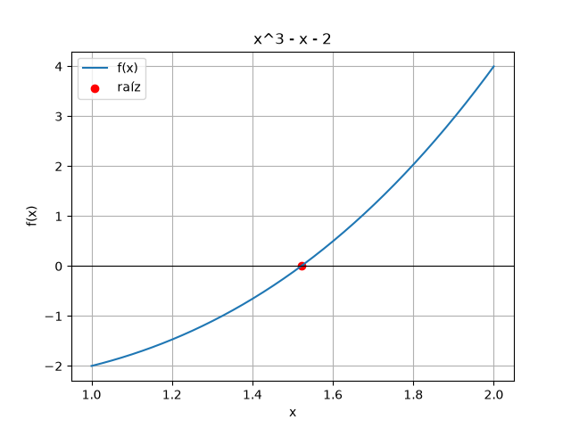 | 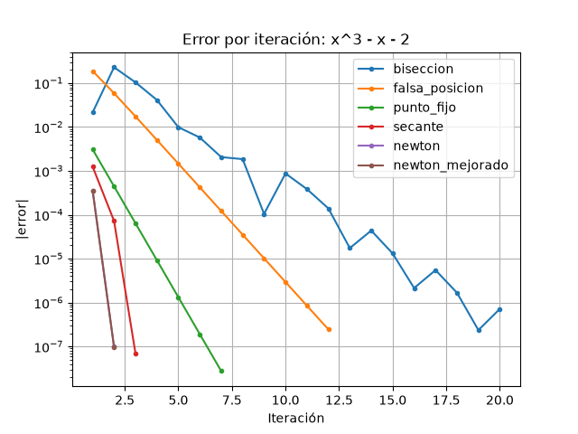 |
| (x − 2)² | 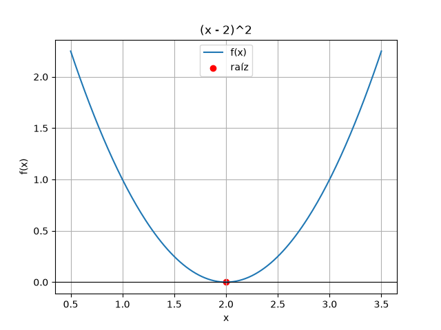 | 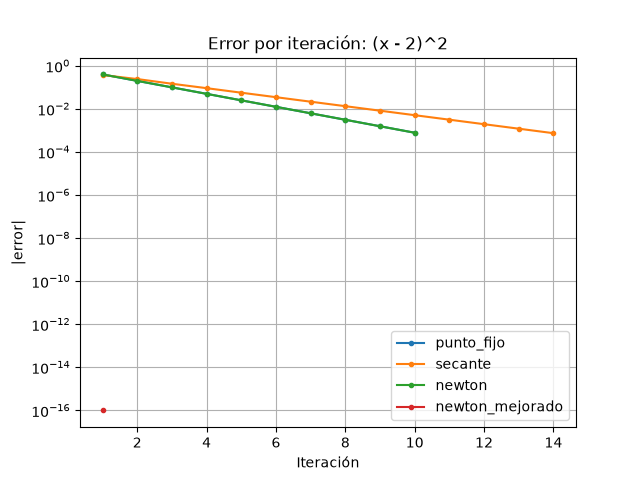 |
| ln(x) + x − 4 | 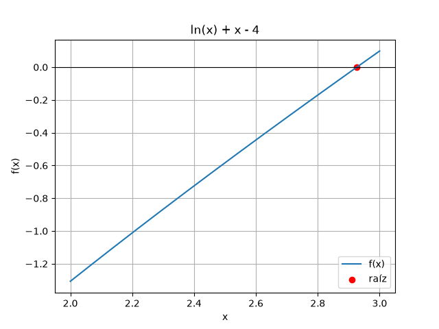 | 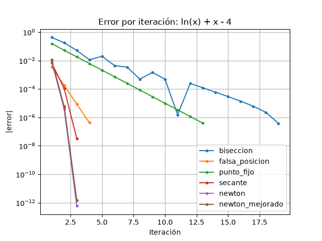 |
| exp(−x) − x | 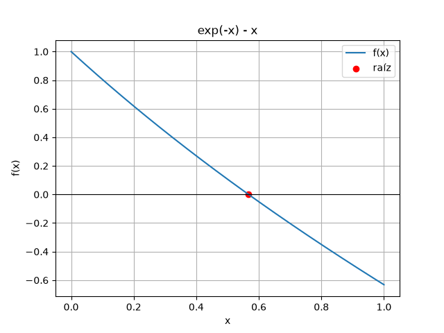 | 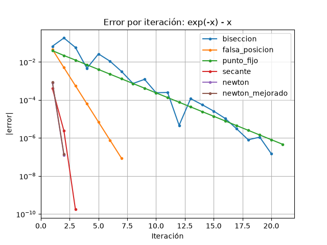 |
| cos(x) − x | 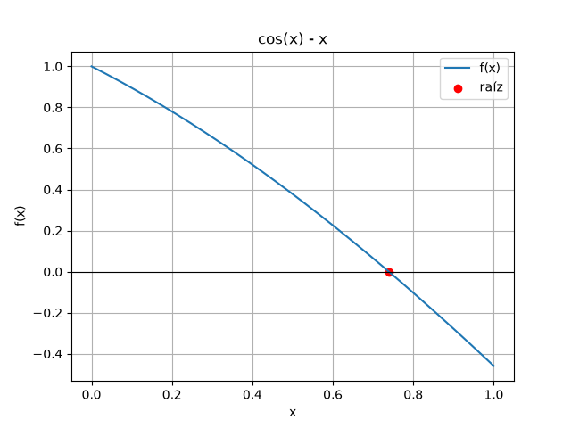 | 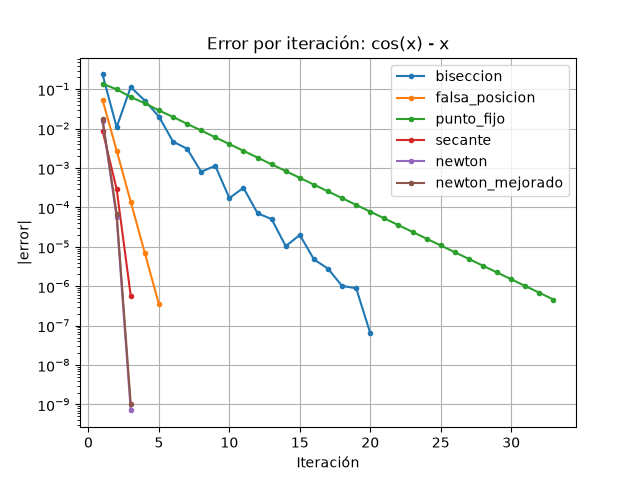 |
| √x − cos(x) | 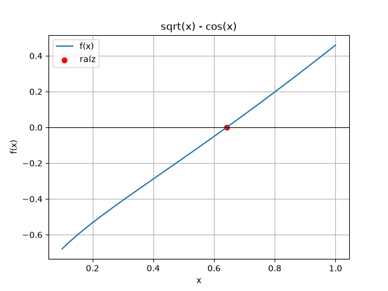 | 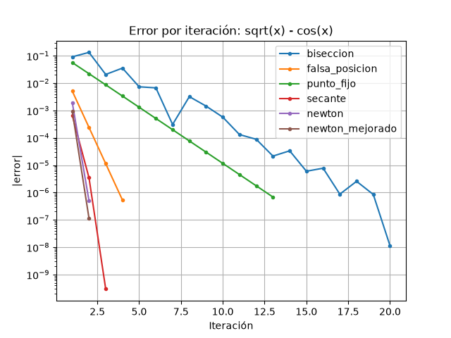 |

Comparación de iteraciones:

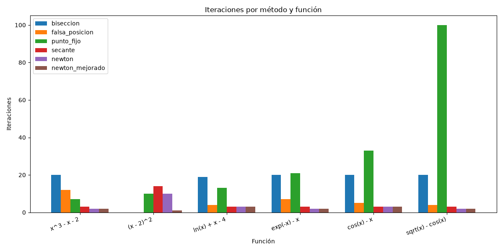

## Respuestas

1. **Método con menos iteraciones:** Newton mejorado necesitó una iteración en la raíz doble y dos en tres funciones. Para las otras, Newton o Newton mejorado usaron entre dos y tres iteraciones. Aprovechan las derivadas y avanzan rápido cerca de la raíz.
2. **Orden de convergencia:** bisección reduce el intervalo de forma lineal; secante suele mostrar convergencia superlineal; Newton cuadrática para raíces simples, y Newton mejorado acelera especialmente raíces múltiples. En las gráficas se ve como una bajada más rápida del error, aunque los puntos dejan de distinguirse cerca de la tolerancia.
3. **Cambio de signo:** bisección y falsa posición lo necesitan. En la raíz doble no hay cambio de signo, así que no aplican.
4. **Raíz doble:** la curva toca el eje en 2 sin cruzarlo. Newton clásico y punto fijo tardaron 10 iteraciones, secante 14 y Newton mejorado llegó a 2 en una iteración.
5. **Intervalo e inicio:** en sensibilidad, bisección del cúbico convergió en 20 iteraciones con [1,2], pero [0,1] no aplica. Newton convergió en 2 a 30 iteraciones según el inicio. Para exp(−x)−x, Newton usó 3 iteraciones desde 0 y 4 desde 2.
6. **Recomendación:** usar bisección si se busca un método seguro y hay cambio de signo; falsa posición reduce iteraciones en varios casos (4 para logaritmo y raíz cuadrada); Newton si se conoce la derivada y el inicio es razonable; Newton mejorado para raíces múltiples. Punto fijo depende mucho de la función g: para √x−cos(x) no convergió en 100 iteraciones.

## Conclusión

Newton y Newton mejorado fueron los más rápidos en cinco funciones, con 2–3 iteraciones; para la raíz doble, Newton mejorado necesitó 1. En cambio, el punto fijo de √x−cos(x) no convergió en 100. Los datos muestran que el método y el inicio sí cambian el resultado.
